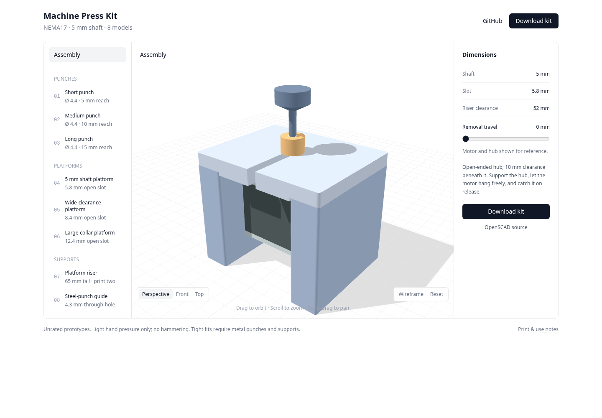

# Machine Press Kit

3D-printable removal tools for 5 mm NEMA17 shafts.

[3D viewer](https://nema17-press-tool-studio.seveibar.chatgpt.site) · [Download kit](dist/models/nema17-press-kit.zip) · [OpenSCAD source](cad/press-kit.scad) · [Print & use notes](dist/models/README.txt)

[](https://nema17-press-tool-studio.seveibar.chatgpt.site)

Includes three punches, three slotted platforms, a riser (print two), and a steel-punch guide.

Requires an open-ended hub and 10 mm clearance beneath it. Unrated prototypes: light hand pressure only; no hammering. Tight fits require metal punches and supports.

## Run locally

```sh
npm ci
npm run build
python3 -m http.server 4173 --directory dist
```

Open <http://localhost:4173>. Edit the viewer in `src/app.js`, styles in `src/style.css`, and markup in `dist/index.html`.

## CAD

Edit `cad/press-kit.scad` in OpenSCAD and export the selected part. Mesh validation and ZIP packaging: `python3 cad/validate.py` (dependencies in `cad/requirements.txt`).
